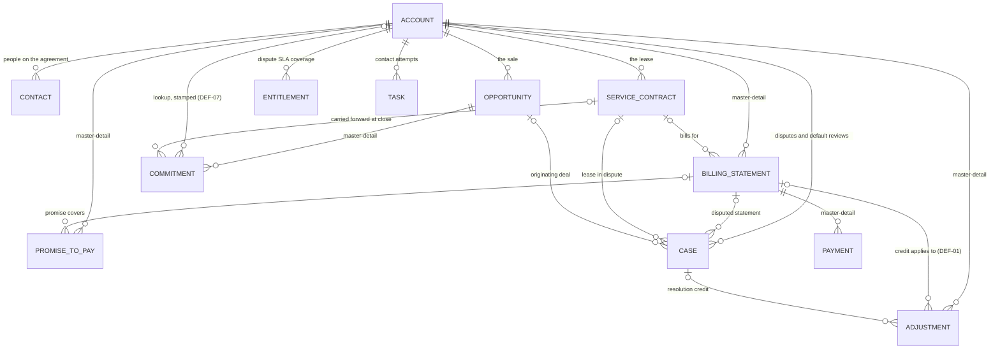

# Data Model — Accord

How Lumenfield's data is structured, why each relationship is what it is, and the order it was built in.

This page describes the org as built. It was reconciled with the org on 2026-11-03; where the build differs from the Phase 3 plan, the difference is called out rather than silently rewritten.

---

## ERD

`||--o{` is master-detail or a required parent; `|o--o{` is an optional lookup. GitHub renders the diagram, and it stays accurate because it lives next to the metadata it describes. Payment is labelled **Lease Payment** in the org (`Payment__c`). Commitment also looks up to the user who recorded it (`Recorded_By__c`), and Account looks up to its primary contact (`Primary_Contact__c`); both are left off the diagram to keep it readable.

---

## Objects

### Standard

| Object | What it holds | Record types |
|---|---|---|
| **Account** | The agreement holder and service address. Per D-01, a household is an Account with the people on it as Contacts. Carries the collections roll-ups (balance, past-due balance, oldest past-due date) and the status that decides who in collections can see it (D-08). | Residential Agreement (88), Organization (12, HOAs and property managers) |
| **Contact** | The people named on the agreement, including co-signers. The account's primary contact is stamped by `Contact_AfterSave_StampPrimaryContact`. | — |
| **Opportunity** | The sale. Commitments hang off it (US-02), and closing it creates the service contract. No products, price books or quotes: no story needs them. | — |
| **Service Contract** | The lease, created when the deal closes (`Opportunity_AfterSave_CreateServiceContract`). | — |
| **Entitlement** | Dispute SLA coverage: one per Residential Agreement account, each on the Billing Dispute SLA process. New disputes get their account's active entitlement from `Case_BeforeSave_StampEntitlement`. | — |
| **Case** | Billing disputes and default reviews (D-03). | Billing Dispute, Default Review |
| **Task** | Contact attempts (US-06), logged through Log Contact Attempt with standard activity fields so history reports work. | — |
| **Lead** | Web inquiries (US-16). | — |

### Custom

| Object | Relationships | Why it exists |
|---|---|---|
| **Commitment** `Commitment__c` | Master-detail → Opportunity · lookups → Account, Service Contract, User (Recorded By) | What a rep promised at signing. Master-detail so a roll-up can count them and a validation rule can block Closed Won without one (US-02). The Account lookup is stamped by `Commitment_BeforeSave_StampAccount` so commitments show on the account, where servicing works (DEF-07). |
| **Billing Statement** `Billing_Statement__c` | Master-detail → Account · lookup → Service Contract | The monthly bill. Master-detail to Account so balance and oldest past-due date roll up to where reps work (D-06). Balance is due − paid − credits (`Credits_Applied__c`, DEF-01). |
| **Lease Payment** `Payment__c` | Master-detail → Billing Statement | Money received. Rolls up to the statement as Amount Paid. |
| **Promise to Pay** `Promise_to_Pay__c` | Master-detail → Account · lookup → Billing Statement (`Related_Statement__c`) | US-03 and US-04. Payments on the related statement decide whether the promise is kept. |
| **Adjustment** `Adjustment__c` | Master-detail → Account · lookups → Case, Billing Statement | Credits and write-offs, with the approval path in US-11. The statement lookup is what lets a posted credit reduce that statement's balance (DEF-01). |

### Custom metadata

| Type | Holds |
|---|---|
| `Policy_Setting__mdt` | Every threshold in the requirements policy table, 9 records. One record per setting, with a number field and a text field, so one type covers all of them. |
| `Dispute_Evidence_Requirement__mdt` | Which evidence each dispute reason requires, driving the checklist in US-07. 16 records, two for each of the 8 reasons. |

### Enabled but unused

**Individual and Contact Point Type Consent.** Data Protection and Privacy is on, so the consent objects exist, but they hold no records and no contact links to an Individual. D-05 chose them for promotional consent, and no promotional automation was built: the only automated messages are servicing ones (welcome, reminder), which send regardless of marketing consent and stop on Do Not Contact. The consent objects are ready for the first promotional flow.

---

## The relationship decisions

**Statements are master-detail to Account, not Service Contract.** Reps work accounts, not contracts, so balance, oldest past-due date, and statement counts need to roll up to the Account. Master-detail is what makes roll-up summaries possible, and an object can only have one master. The Service Contract link stays as a lookup, which is enough for reporting. See D-06.

**Payments are master-detail to Statement.** A payment belongs to a bill, and `Amount_Paid__c` on the statement is a roll-up of its payments. The known limit: a single payment covering two statements can't be split. A production build would add a payment allocation junction object. That's written in the README's limits section rather than built.

**Commitments are master-detail to Opportunity, with a lookup to Account.** The validation rule in US-02 has to count child commitments, and a validation rule can only see fields on the record being saved, so the count has to be a roll-up summary, which requires master-detail. This is the clearest example in the build of a requirement dictating a relationship type rather than the other way around. The master is the deal, though, and servicing works the account, so commitments were invisible where they mattered. A lookup to Account, stamped from the deal on save, puts them on the account's related list (DEF-07).

**Adjustments are master-detail to Account, with lookups to Case and Billing Statement.** Most adjustments come from disputes, but not all: a billing correction can happen without one. The Account relationship is the one that's always true. The statement lookup was added for DEF-01: a lookup can't roll up, so `Adjustment_AfterSave_ApplyCredits` sums posted credits into the statement's `Credits_Applied__c`, and the balance formula subtracts them.

**Entitlements hang off the Account, not the Service Contract.** The plan tied SLA coverage to the service contract. As built, each Residential Agreement account carries one entitlement: every residential lease gets the same dispute SLA, and a dispute always has an account, while its link to the lease (`Case.Service_Contract__c`) is optional. A new residential account doesn't get an entitlement automatically; that's in the README's known limits.

---

## Why statement status is a stamped field, not a formula

`Status__c` on Billing Statement is a picklist (Open, Past Due, In Dispute, Paid, Written Off) kept current by a nightly scheduled flow, `Billing_Statement_Daily_Status`, not a formula that calculates from the due date.

Formula fields using `TODAY()` can't be used in roll-up summary filter criteria, because the value changes without the record changing. Past Due Balance and Oldest Past Due Date on the Account are roll-ups filtered on Status = Past Due, and Days Past Due, Account Status and the collections sharing rule all follow from them. So status has to be a real stored field for the filter to work, and something has to store it.

That something was missing until DEF-12 (2026-11-03): the design said a nightly flow stamps the status, but none was built. Statements loaded as Open stayed Open after their due date, so a customer who stopped paying never reached collections. The flow now runs each morning before `Account_Daily_Collections_Status`: nothing owed → Paid, still owing after the due date → Past Due. In Dispute is owned by `Case_AfterSave_DisputeLifecycle`, which restores the real status when the dispute closes.

The same constraint drives `Broken_Promises_90d__c` on Account. A rolling 90-day count can't be a roll-up, so a scheduled flow stamps it.

This comes up in interviews as "when would you use a formula versus a field updated by automation," and this is a concrete answer rather than a textbook one, including what happens when the automation half of the answer is missing.

---

## US-15 is evaluated at the account

The story was first written about a *service contract* crossing the default threshold. Because past-due balance and days past due roll up to Account, the evaluation runs at the Account level, and US-15 is worded that way: an account reaching 90 or more days past due gets a Default Review.

---

## Build order

Dependencies decided the order. Building out of order means going back.

1. **Global value sets**: Contact Outcome, Dispute Reason, Root Cause, Commitment Type. Shared value sets keep reporting consistent across objects.
2. **Custom metadata types**, then their records, so the Phase 7 automation had thresholds to read.
3. **Custom objects** in this order: Commitment, Billing Statement, Payment, Promise to Pay, Adjustment, each created with its master-detail relationship rather than converted later.
4. **Fields on standard objects**: Account, Opportunity, Service Contract, Case, Contact, Lead.
5. **Roll-up summaries** on Account and Opportunity, once the child fields existed.
6. **Formula fields** last, since several read roll-up values.
7. **Data Protection and Privacy** enabled, so the consent objects exist.
8. **Page layouts** for the new objects and a first Account record page for US-01. The Collections Console came in Phase 6.
9. **Retrieve and commit.**

---

## Gotchas

- **Master-detail can't be added cleanly later.** Converting a lookup to master-detail requires every child record to already have a parent. Decide before any data loads.
- **Master-detail children have no owner and no sharing of their own.** They inherit from the parent. That's intentional: it's what keeps the security model simple.
- **Roll-up filters can't reference dynamic formulas.** Covered above. The stored field it forces on you needs automation behind it, or it quietly goes stale (DEF-12).
- **Set auto-number formats when you create the object.** Commitment `COM-{00000}`, Billing Statement `STMT-{00000}`, Lease Payment `PAY-{00000}`, Promise to Pay `PTP-{00000}`. Adjustment was planned as `ADJ-{00000}` but was built with a text name, and records created without one show their record ID. It was converted on 2026-11-03, after Steward's test data stopped naming adjustments. Converting doesn't renumber records that already exist, so the 12 seeded adjustments keep their record IDs as names until the next re-age rebuilds them.
- **Descriptions are not optional.** Every field gets one explaining why it exists. Doing it as you go takes seconds; doing it for sixty fields later takes an evening you won't have.

---

## Known gaps

- **Organization accounts have leases.** The 12 Organization accounts each have a Closed Won deal and the lease it created, but no bills, though the record type describes "a relationship account, not a lease holder." Either the description changes or the leases and deals go; the decision is in `open-items.md`.
- **Adjustment names.** The auto-number arrived late, so the 12 seeded adjustments show record IDs until the next re-age (Gotchas, above).
