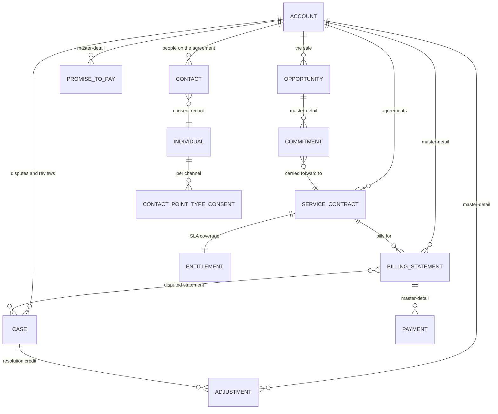

# Data Model — Accord

How Lumenfield's data is structured, why each relationship is what it is, and the order to build it in.

---

## ERD

GitHub renders this diagram automatically. Export a Schema Builder view later for the case study, but this is the version that stays accurate because it lives next to the code.

---

## Objects

### Standard, used as-is

| Object | Why it's standard | Record types |
|---|---|---|
| **Account** | The agreement holder and service address. Per D-01, a household is an Account with the people on it as Contacts. | Residential Agreement, Organization (HOA and property managers) |
| **Contact** | The people named on the agreement, including co-signers. | — |
| **Opportunity** | The sale. Products, Price Books, and Quotes hang off it in Phase 8. | — |
| **Service Contract** | The lease itself. Standard because entitlements attach to it, which is what drives dispute SLAs. | — |
| **Entitlement** | The SLA coverage behind the milestone clock in US-09. | — |
| **Case** | Disputes and default reviews, per D-03. | Billing Dispute, Default Review |
| **Task** | Contact attempts in US-06, using standard activity fields so history reports work. | — |
| **Lead** | Web inquiries in US-16. | — |
| **Individual / Contact Point Type Consent** | Consent per channel with effective date and source, per D-05. Enabled under Data Protection and Privacy. | — |

### Custom

| Object | Parent relationship | Why it exists |
|---|---|---|
| **Commitment** `Commitment__c` | Master-detail → Opportunity | What a rep promised at signing. Master-detail so a roll-up can count them and a validation rule can block Closed Won (US-02). |
| **Billing Statement** `Billing_Statement__c` | Master-detail → Account, lookup → Service Contract | Monthly bill. Master-detail to Account so balance and oldest past-due date roll up to where reps work. |
| **Payment** `Payment__c` | Master-detail → Billing Statement | Money received. Rolls up to the statement, which produces balance. |
| **Promise to Pay** `Promise_to_Pay__c` | Master-detail → Account, lookup → Billing Statement | US-03 and US-04. |
| **Adjustment** `Adjustment__c` | Master-detail → Account, lookup → Case | Credits and write-offs, with the approval path in US-11. |

### Custom metadata

| Type | Holds |
|---|---|
| `Policy_Setting__mdt` | Every threshold in the requirements policy table. One record per setting, with a number field and a text field so one type covers all of them. |
| `Dispute_Evidence_Requirement__mdt` | Which evidence each dispute reason requires, driving the dynamic checklist in US-07. |

---

## The relationship decisions

**Statements are master-detail to Account, not Service Contract.** Reps work accounts, not contracts, so balance, oldest past-due date, and statement counts need to roll up to the Account. Master-detail is what makes roll-up summaries possible, and an object can only have one master. The Service Contract link stays as a lookup, which is enough for reporting and for the entitlement tie. See D-06.

**Payments are master-detail to Statement.** A payment belongs to a bill, and `Amount_Paid__c` on the statement is a roll-up of its payments. The known limit: a single payment covering two statements can't be split. A production build would add a payment allocation junction object. That's written in the README's limits section rather than built.

**Commitments are master-detail to Opportunity.** The validation rule in US-02 has to count child commitments, and a validation rule can only see fields on the record being saved — which means the count has to be a roll-up summary, which requires master-detail. This is the clearest example in the build of a requirement dictating a relationship type rather than the other way around.

**Adjustments are master-detail to Account with a lookup to Case.** Most adjustments come from disputes, but not all — a billing correction can happen without one. The Account relationship is the one that's always true.

---

## Why statement status is a stamped field, not a formula

`Status__c` on Billing Statement is a picklist updated by a nightly scheduled flow, not a formula that calculates from the due date.

Formula fields using `TODAY()` can't be used in roll-up summary filter criteria, because the value changes without the record changing. Balance and oldest past-due date on the Account are roll-ups filtered on status, so status has to be a real stored field for the filter to work.

The same constraint drives `Broken_Promises_90d__c` on Account. A rolling 90-day count can't be a roll-up, so a scheduled flow stamps it.

This comes up in interviews as "when would you use a formula versus a field updated by automation," and this is a concrete answer rather than a textbook one.

---

## Amendment to US-15

The story says a *service contract* crossing the default threshold triggers a review. Because past-due balance and days past due roll up to Account, the evaluation runs at the **Account** level instead. Update the story wording so the requirement and the model agree — silent drift between the two is exactly what makes documentation useless.

---

## Build order

Dependencies matter here. Building out of order means going back.

1. **Global value sets** — Contact Outcome, Dispute Reason, Root Cause, Commitment Type. Shared value sets keep reporting consistent across objects.
2. **Custom metadata types**, then their records. Automation in Phase 7 reads these, so they exist now.
3. **Custom objects** in this order: Commitment, Billing Statement, Payment, Promise to Pay, Adjustment. Create the master-detail relationship *when you create the object*, not later.
4. **Fields on standard objects** — Account, Opportunity, Service Contract, Case, Contact, Lead.
5. **Roll-up summaries** on Account and Opportunity. These need the child fields to exist first.
6. **Formula fields** last, since several read roll-up values.
7. **Enable Data Protection and Privacy** so the consent objects appear.
8. **Page layouts** for the new objects, and a first pass at the Account record page for US-01. The console app comes in Phase 6.
9. **Retrieve and commit.**

---

## Gotchas

- **Master-detail can't be added cleanly later.** Converting a lookup to master-detail requires every child record to already have a parent. Get it right now, before any data loads.
- **Master-detail children have no owner and no sharing of their own.** They inherit from the parent. That's intentional — it's what makes the Phase 4 security model simple.
- **Roll-up filters can't reference dynamic formulas.** Covered above; it will bite you at least once anyway.
- **Auto-number format is permanent-ish.** Set display formats now: `COM-{00000}`, `STMT-{00000}`, `PAY-{00000}`, `PTP-{00000}`, `ADJ-{00000}`.
- **Descriptions are not optional.** Every field gets one explaining why it exists. Doing it as you go takes seconds; doing it for sixty fields later takes an evening you won't have.

---

## If time is short

Build this subset first — it carries every Must story on the collections and dispute path:

Account fields · Billing Statement · Payment · Promise to Pay · Commitment · Opportunity fields · Service Contract fields

Defer until after the exam: Adjustment, Lead fields, and the forecast fields. They support Should and Could stories only.
